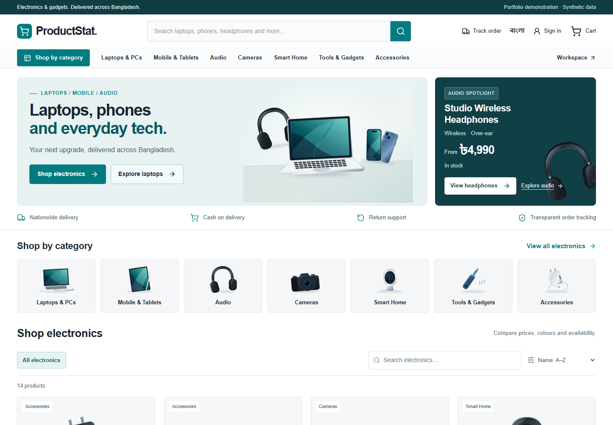

# ProductStat Commerce

[](https://github.com/Shadman-Al-Muksit/productstat-commerce/actions/workflows/verify.yml)

A Bangladesh electronics store connecting a customer storefront, staff operations and auditable product analytics. Built for one company, BDT and domestic physical-goods delivery.

The useful question is not only “what sold?” A manager can follow a product from ordered units to delivery outcomes, accepted returns and confirmed money movements, then inspect the contributing records.



See the [release status](docs/RELEASE_STATUS.md) and [validation evidence](docs/VALIDATION.md) for the tested scope and operating limits.

## Run locally

Development and backend verification use Ubuntu WSL. Source files remain on the Windows D: drive; database files and dependencies live in the separate Linux runtime `~/.local/share/productstat`.

```bash
cd /mnt/d/Shadman-Desktop/Career/productstat
# First installation only, if PostgreSQL17/Redis/Python venv prerequisites are missing:
sudo bash scripts/install-system.sh
bash scripts/setup.sh
bash scripts/seed.sh
bash scripts/dev.sh
```

Open **http://localhost:3000**. On Windows, `Start-ProductStat.ps1` starts the same WSL application. Local API documentation is at **http://localhost:8001/api/v1/docs/**.

For a local preview of the optimized frontend, run `npm run build` in `frontend`, then `bash scripts/dev.sh --preview`. This still uses local demo settings; HTTPS deployment uses the separate Compose configuration. The launcher refuses duplicate application ports and stops its owned process groups together.

`seed_demo` creates 2,000 SKUs, 25,000 historical orders and 75,000 lines across a synthetic year. `--small` creates a smaller fresh-development fixture. Existing seeded history and live stock are not reset by repeated seeding. Never change fixture size by deleting business data.

Fresh seeds contain electronics: laptops/PC accessories, phones/tablets, audio, cameras, smart home and tools/gadgets. To switch an existing mixed demo catalogue, preview `python manage.py curate_electronics` from `backend` with `scripts/env.sh` sourced, then use `--apply --actor administrator` to publish 14 products with 42 colour SKUs. The command archives previous listings, preserves stock and transaction history, and leaves existing curated prices/stock unchanged on repeated runs. See the [storefront update](docs/STOREFRONT.md).

Local-only demonstration accounts:

| Username | Role |
|---|---|
| `administrator` | Company settings, access, operations and financial confirmations |
| `operator` | Catalogue, stock, fulfilment and returns |
| `analyst` | Redacted reports and exports |
| `customer` | Own orders and account |

Local development password: `ProductStatDemo!2026`. Production seeding refuses this default and requires separate private administrator and viewer passwords. Do not publish the local writable account credentials with a hosted demo.

## Supported workflows

- English/Bangla electronics storefront, catalogue search/filtering, colour-specific product images, persistent cart, guest checkout and customer accounts. Larger typography, category tiles, a search-led header and a circular cart quantity badge support desktop and mobile use.
- Staff image editing provides the electronics image library, public local/HTTPS references, previews and per-variant colour/image controls. Existing metadata and stock are preserved; courier settlement confirmation requires an active administrator or superuser on the backend.
- Server-validated prices/charges, atomic reservations, replay-safe checkout and private guest order links.
- Staff preparation, dispatch, delivery failures, partial cancellation, COD collection and courier settlement.
- Partial returns, receipt/inspection, stock disposition, refund obligations and verified refund recording.
- Typed REST API, backend role permissions, session/CSRF protection, audit events and redacted request logs.
- Product and SKU activity reports, delivery-cohort return rates, accepted-return reasons, comparisons, event drilldowns and matching CSV exports. Net delivered merchandise subtracts accepted returns at inspection; cash collections, settlements and refunds remain separate measures.
- Historical-date coverage identifies records that cannot be assigned to a reporting period. Missing source dates remain unknown.
- Validated catalogue/inventory/historical CSV batches, durable queued work and exact-repeat/conflict checks. Administrator-reviewed historical revisions retain the original financial evidence and include only the current revision in reports.
- Protected operational health checks flag COD orders waiting at least 48 hours, exhausted background work, failed imports and unreconciled payment exceptions. The CLI and timer expose attention signals for a deployment's alert receiver.

COD works locally. **SSLCOMMERZ requires real sandbox merchant credentials** in the ignored `.env`; absent credentials produce an explicit unavailable response. A browser success redirect never proves payment. Sandbox money cannot authorize real-company fulfilment. Refund confirmation records external evidence; it does not pretend to execute a gateway transfer.

## Architecture

Next.js16/TypeScript → Django5.2/DRF → PostgreSQL17, with Celery/Redis background work. Django owns business rules and reporting calculations. UI figures, drilldowns and exports share the reporting services.

The local WSL1 kernel needs Node22 LTS and Next's webpack mode; modern Linux deployment images use Node24. The setup scripts select the compatible runtime without replacing other projects' dependencies.

See [architecture](docs/ARCHITECTURE.md), [core API](docs/API_CORE.md), [reporting API](docs/API_REPORTING.md), [metric definitions](docs/METRICS.md), [import schemas](docs/IMPORTS.md), [OpenAPI](docs/openapi.yaml) and [operational runbook](docs/OPERATIONS.md).

## Verification

```bash
bash scripts/check.sh                 # Backend checks/tests + TypeScript + production build
bash scripts/schema.sh                # Validate OpenAPI and regenerate TypeScript definitions
bash scripts/seed-check.sh             # Before/after proof that reseeding does not change data
bash scripts/recovery-test.sh         # Encrypted backup and isolated database/media restore
python3 scripts/install-validation-tools.py
bash scripts/load-test.sh             # 20 browsing sessions + five staff sessions, local k6
```

With the application running, execute `npm run test:e2e` from `frontend`. On this WSL1 machine, use Windows Node with the installed Windows Playwright Chromium; the application/database still run in WSL. Set `PLAYWRIGHT_EXECUTABLE_PATH` if a browser location must be supplied.

The latest local verification passed **213 backend tests and nine browser journeys**, including settlement authorization, image-editor persistence and homepage product pricing. TypeScript, formatting, OpenAPI and the optimized build passed. The initial release also verified dependency advisory checks and encrypted recovery. The earlier two-minute 25-user API run completed 2,767 requests without errors, with catalogue p95 **79 ms** and analytics p95 **1.956 s**. Those performance measurements describe that earlier workload and environment; see the [validation record](docs/VALIDATION.md). A successful local demonstration is not evidence of a hosted production deployment.

## Deployment boundary

The Docker Compose/Caddy configuration targets a single Ubuntu server, private database/Redis networks, persistent media and an encrypted-backup maintenance container. It is not a marketplace, international-commerce engine or accounting ledger. One shipment per live order is supported; historical related files retain shared external shipment identities.

Deployment requires a domain/server, unique secrets, SMTP configuration when real notifications are enabled, a separately protected backup key and an off-server backup destination. Live online payment collection remains a separate release gate after merchant onboarding and transaction/refund reconciliation.
