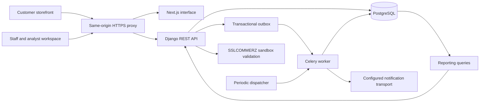
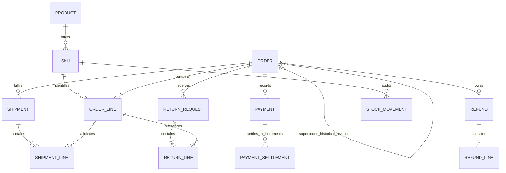

# Architecture and data ownership

Django is the authority for money, stock, permissions and transitions. Next.js does not duplicate checkout or reporting rules. Cookies use the shared origin, and unsafe guest requests receive the same CSRF protection as authenticated requests.

## Main relationships

Product and SKU changes do not rewrite historical order snapshots. `on_hand − reserved` is available stock. Checkout locks inventory; dispatch consumes reservations; cancellation releases them; inspected returns create separate stock movements. A refund is a money record, independent of physical receipt.

Live checkout supports one shipment. Historical migration can retain external event identities from related CSV files. Historical observations feed supported reports but never replay live operations.

Historical source identities permit one current revision. An administrator-approved correction preserves the previous order and its immutable payment, settlement and event records, then creates a linked replacement. Reporting uses current revisions; audit records retain the reviewer, reason and previous/new identifiers. Unknown historical dates remain NULL, with coverage reported separately from dated metrics. This does not change live inventory or replay customer operations.

## Decisions

- Modular monolith: transactional boundaries stay in one database. Celery runs the same backend codebase.
- Decimal money with BDT currency; UTC storage and Asia/Dhaka business dates.
- Operational reporting stays in PostgreSQL. A separate warehouse is unnecessary for the selected workload.
- Stock movements and audit events explain changes; imported files remain private.
- Delivery cohorts prevent unrelated monthly sales and returns from being combined into a misleading rate.
- Synthetic demonstration records live in their own deployment/database. Financial test activity cannot enter a real company fulfilment workflow.
- Versioned REST APIs and generated TypeScript definitions make wire changes reviewable.
